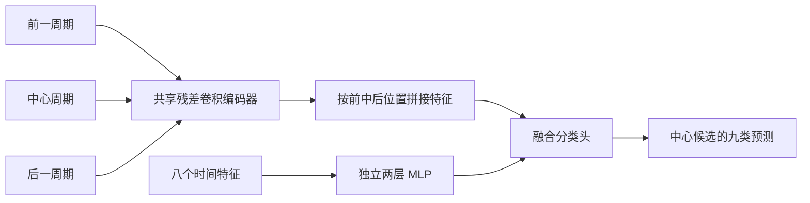

# 单拍标签与新网络

本轮按用户要求重新设计：一个目标候选心拍只有一个原始标签，不做十秒窗口异常投票。九类为 A、B、F、L、N、R、S、V 和伪迹。A/S、V/F 保持独立，起搏拍不再归为 N。

标注类别说明来自 [PhysioNet 官方标注表](https://physionet.org/static/lightwave/doc/annotations.html)。伪迹类别不是生理心拍，数据中保留它作为类似 QRS 的噪声候选。

## 单拍边界

对候选位置 t[i]，中心拍区间是相邻候选中点：

`left = floor((t[i-1]+t[i])/2)`，`right = floor((t[i]+t[i+1])/2)`。

相邻周期不重叠，标签只来自 t[i] 的原始标注。它是基于候选位置的周期近似划分，不保证每条样本都包含完整且仅包含一组 P-QRS-T 的全部波形边界。

每个周期变长截取后线性插值到 256 点，独立去均值、除标准差。由于时间轴缩放会改变表观宽度，另外保留周期时长和 RR 特征。没有先切十秒再继承整段标签，也没有加入新的带通滤波。

原始不属于目标九类的有效候选可以作为邻拍上下文，类别编码为 -1，不能成为训练目标。缺失、恒定、长度异常或无完整邻拍的目标会排除。伪迹参与候选时序，因此含伪迹附近的间隔不能直接解释为纯生理 RR。

## 两路输入

- 波形 `[batch,3,256]`：前一周期、中心周期、后一周期。邻拍标签不输入模型，输出只针对中心。
- 时间 `[batch,8]`：前 RR、后 RR、相对过去八个 RR 中位数的两个比值、前后 RR 比、局部 RR 中位数、中心候选在周期中的相对位置、周期时长。大尺度值取对数，比值作固定范围截断。

时间特征的均值和标准差只由实际选用的训练目标计算。没有使用验证或测试标签构造特征。

## 网络

形态编码器依次为：16 通道、核 11、步长 2 的卷积，然后三个残差块，通道 24/48/64，主核 9/7/5，步长均为 2。每块还含核 5 的卷积，采用 GroupNorm 和 SiLU，最后全局平均池化得到每拍 64 维。

三拍特征合计 192 维，加 RR 分支 32 维，形成 224 维融合输入，经 96 维隐层和 dropout 输出九类 logits。模型共 91,193 参数。没有原网络的 LSTM。

对照模型使用同一个形态编码器，只输入中心周期到分类头，不使用相邻拍和 RR。其数据、记录划分、训练样本选择、损失权重和选点规则保持一致；同协议比较才能评价新分支的作用。

## 训练协议

固定 seed=0，AdamW、学习率 0.001、weight decay 0.01、batch 512，最多 30 轮，验证集有支持类别 macro-F1 选点，连续 8 轮未改善早停。

训练集每条记录最多随机保留 3000 个 N，异常拍全部保留。类别权重为训练计数的逆平方根并作上限截断，实际数值写入每次运行配置。验证与测试保持全部合格目标。

B 没有验证和测试来源；测试 F 只有 8 拍、来自两个记录组，不能对其表现作稳定结论。单拍数量不能代替独立受试者数量。整体准确率受 N 大量占比影响，应同时看 macro-F1 与各异常类别精确率、召回率。

使用专家标注候选位置和 RR，属于离线理想定位评估。后一周期与后 RR 需要未来数据，部署时要等待后续拍并接入自动候选检测器。此次不宣称已经验证检测误差、实时延迟或真实采集效果。
